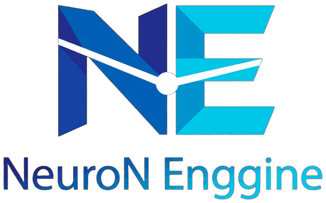

# NeuroN Engine

<p align="center">
  
</p>

**NeuroN Engine** adalah engine AI lokal untuk Android. Aplikasi ini menjalankan model GGUF di perangkat (llama.cpp), atau memakai API OpenAI-compatible, lalu menyediakan konfigurasi model, RAG, server lokal OpenAI-compatible, copilot untuk memperbaiki konfigurasi, dan pelatihan LoRA lewat server Python.

> **Status: alpha (v0.2.2).** UI Flutter memakai shell mobile-first Beranda/Chat/Library/Import/Lainnya; editor lama hanya tersedia sebagai Workspace tanpa rail IDE permanen. GitHub Actions membangun APK universal pada rilis. Tanpa keystore privat, APK memakai debug signing dan hanya layak untuk uji instalasi, bukan distribusi produksi. Beberapa alur import/training belum tersedia dan inferensi lokal memerlukan library llama.cpp native yang sesuai ABI. Lihat [Status fitur](#status-fitur), [ringkasan perubahan UI](docs/UI_REFRESH.md), dan [docs/RELEASE.md](docs/RELEASE.md).

---

## Daftar isi

1. [Ringkasan](#ringkasan)
2. [Migrasi ke Flutter (2026-11-09)](#migrasi-ke-flutter-2026-11-09)
3. [Arsitektur](#arsitektur)
4. [Struktur repo](#struktur-repo)
5. [Status fitur](#status-fitur)
6. [Konfigurasi project: 7 bagian](#konfigurasi-project-7-bagian)
7. [Memulai: prasyarat](#memulai-prasyarat)
8. [Menjalankan UI Flutter](#menjalankan-ui-flutter)
9. [Modul Kotlin dan engine lokal](#modul-kotlin-dan-engine-lokal)
10. [Server pelatih Python](#server-pelatih-python)
11. [Server lokal OpenAI-compatible](#server-lokal-openai-compatible)
12. [Aset logo dan ikon](#aset-logo-dan-ikon)
13. [Keamanan](#keamanan)
14. [Batasan dan hal yang belum siap](#batasan-dan-hal-yang-belum-siap)
15. [Roadmap](#roadmap)
16. [Verifikasi](#verifikasi)
17. [Dokumentasi](#dokumentasi)
18. [Lisensi](#lisensi)

---

## Ringkasan

| Area | Yang disediakan | Lokasi |
|---|---|---|
| **UI Android** | Beranda, Chat, Library, Import Center, Activity, Workspace editor; halaman model/server/RAG/HF | `flutter_app/` (Flutter) |
| **Konfigurasi** | 7 bagian config dalam satu file project: parameter chat, file model, tokenizer, pengetahuan tambahan, pelatihan ulang, hardware, fitur | `model/`, `project/` |
| **Engine** | Antarmuka `InferenceEngine` dengan dua implementasi: llama.cpp lokal (JNI) dan API OpenAI-compatible | `engine/` |
| **Hugging Face** | Cari dan unduh model: resume, WorkManager, verifikasi SHA-256, token untuk model gated | `hf/` |
| **RAG** | Pemrosesan dokumen (txt, md, docx, pdf), chunking, vector store SQLite, sumber di jawaban | `rag/` |
| **Server lokal** | Endpoint OpenAI-compatible di HP (`/v1/chat/completions`, `/v1/models`, `/v1/embeddings`, `/health`), API key, SSE | `server/` |
| **Copilot** | Saran patch config (diff, terima/tolak), eval sebelum/sesudah, cek konsistensi tokenizer | `copilot/` |
| **Pelatihan** | Dataset (jsonl/csv/json), split train/val, trainer REMOTE (server Python) dan ON_DEVICE (kerangka) | `train/`, `python/` |
| **Server pelatih** | FastAPI: upload dataset, SFT/LoRA/QLoRA/DPO, konversi GGUF, quantize, merge, inspeksi | `python/` |

Aturan utama: **semua pemanggilan AI lewat `InferenceEngine`.** UI, server, RAG, dan copilot tidak tahu engine mana yang dipakai.

---

## Migrasi ke Flutter (2026-11-09)

UI Android sebelumnya ditulis dengan Jetpack Compose di modul `app/`. Sejak 2026-11-09 UI ditulis ulang di **Flutter** di folder `flutter_app/`.

- **Entry point APK** sekarang proyek Flutter. Modul `app/` Compose dihapus. Modul itu sudah tidak punya layar UI sejak sebelum migrasi.
- **Modul Kotlin library** (`model`, `project`, `hf`, `engine`, `rag`, `train`, `server`, `copilot`) dan **`python/`** tidak berubah.
- **Identitas seragam:** applicationId `com.neuron.engine`, nama aplikasi "NeuroN Engine", versi `0.2.2+4`.
- **Logo** dikompres dari 415 KB menjadi sekitar 73 KB total dan dipakai sebagai header serta ikon launcher adaptif.
- **Flutter** tersambung ke project dan modul Kotlin untuk chat API, mode lokal, server, RAG, dan Hugging Face. Pelatihan dan Copilot belum dibuat ulang sebagai alur Flutter.

Rincian lengkap (peta layar lama → Flutter, perubahan Gradle, risiko, dan langkah berikutnya) ada di [docs/MIGRASI_FLUTTER.md](docs/MIGRASI_FLUTTER.md).

---

## Arsitektur

```
flutter_app/  UI Flutter (entry point APK com.neuron.engine)
   │
   │  MethodChannel/EventChannel ke Kotlin untuk project, chat, server, RAG, dan HF
   ▼
modul Kotlin (root Gradle; dipakai sebagai library oleh APK Flutter)
   ├─ model    data class config, validasi, SecretStore
   ├─ project  AiProject ↔ file virtual (VirtualTree), simpan/muat project.json
   ├─ engine   InferenceEngine ─┬─ LlamaCppEngine (JNI llama.cpp, GGUF)
   │                            └─ RemoteApiEngine (HTTP, OpenAI-compatible)
   ├─ rag      Chunker, FileParser, vector store, RagPipeline (embedding lewat engine)
   ├─ hf       unduh model Hugging Face (WorkManager, resume, SHA-256)
   ├─ train    Dataset, Trainer { REMOTE | ON_DEVICE }, ModelOpsClient
   ├─ server   Ktor OpenAI-compatible + LocalServerService (foreground)
   └─ copilot  saran patch config, Eval, cek konsistensi tokenizer

python/  NeuroN Trainer (FastAPI) di PC/server. Dipanggil dari APK lewat HTTP.
         Python TIDAK berjalan di dalam APK (PyTorch/PEFT tidak tersedia di Android).
```

Alur data: file project (7 bagian) → `VirtualTree` memvalidasi dan membaca/menulis → modul terkait. Parameter generate dihitung oleh `engine/ModelDefaults.kt` dengan prioritas `chat/params.json` yang sudah diubah → `model/Modelfile` → `model/generation_config.json` → bawaan.

---

## Struktur repo

```
NeuroNEngine/
├─ README.md                    dokumen ini
├─ branding/
│  └─ neuron_logo.png           logo penuh (640 px, dikompres); tidak masuk APK
├─ flutter_app/                 UI Android (Flutter)
│  ├─ lib/main.dart             shell mobile-first, state chat/Workspace, bridge actions
│  ├─ lib/feature_workspace.dart layar model lokal, server, RAG, HF, dan fitur tertunda
│  ├─ assets/images/            neuron_mark.png (mark "NE" untuk header; masuk APK)
│  ├─ android/                  host Android: manifest, ikon adaptif, Gradle modul :app
│  ├─ design/                   mockup ilustratif UI v0.2
│  ├─ pubspec.yaml              nama neuron_engine, versi 0.2.2+4
│  └─ README.md                 panduan khusus Flutter
├─ model/       data class config (AiProject, ChatParams, ModelFiles, ...), validasi, SecretStore
├─ project/     simpan/muat project.json, VirtualTree (path file ↔ config), ExplorerSections
├─ engine/      InferenceEngine: LlamaCppEngine (JNI) | RemoteApiEngine (OpenAI-compatible)
│               + ModelDefaults, ToolEngine, Guardrails, EngineHub, EngineFactory
├─ rag/         Chunker, FileParser (txt/md/docx/pdf), vector store SQLite/memory, RagPipeline
├─ hf/          cari & unduh model Hugging Face (WorkManager, resume, SHA-256)
├─ train/       Dataset, Trainer (REMOTE / ON_DEVICE), ModelOpsClient
├─ server/      server lokal Ktor OpenAI-compatible (foreground service)
├─ copilot/     saran perbaikan config (diff + terima/tolak), Eval, cek konsistensi
├─ python/      NeuroN Trainer (FastAPI): training, konversi GGUF, operasi model
├─ docs/        roadmap, status, arsitektur, panduan per fitur, catatan migrasi
├─ scripts/
│  ├─ setup_native.sh         menambah submodule llama.cpp (dan Vulkan-Headers dengan --vulkan)
│  └─ make_brand_assets.py    membuat ulang logo, mark, dan ikon launcher dari logo sumber
├─ build.gradle.kts, settings.gradle.kts, gradle.properties
├─ gradlew, gradlew.bat, gradle/wrapper/   Gradle 8.10.2 untuk modul Kotlin library
└─ .gitignore
```

---

## Status fitur

Legenda: **Ada** = tersedia di UI; **Terhubung (dasar)** = memanggil modul namun perlu verifikasi perangkat; **Belum** = alur UI belum dibuat ulang.

| Area | Kode (modul) | UI Flutter saat ini | Catatan |
|---|---|---|---|
| Editor JSON (`params.json`, `config.json`) | `project` | **Ada** (dua file tetap) | Nomor baris, cari dan ganti, Rapikan, status JSON valid |
| Inspektur parameter | `model` | **Ada** | Slider temperature, top-p, top-k, max tokens; seed |
| Muat / simpan file JSON | — | **Ada** | Lewat file picker sistem, belum dari project |
| Undo / redo, highlight JSON | — | Belum | Tombol ada, belum berfungsi |
| Tab file, buat/hapus file, Explorer | `project` (`VirtualTree`) | Belum | Editor kode Kotlin lama sudah punya tab dan auto-indent, belum dibuat ulang |
| Chat | `engine` | **Terhubung** | Streaming API atau LOCAL via `EngineHub`; RAG memberi konteks bila indeks aktif |
| Log | — | **Ada** (teks sederhana) | Diagnostik RAM/ABI belum ada |
| Copilot (saran, diff, terima/tolak, eval) | `copilot` | **Belum** | Modul ada; workflow UI Flutter belum dibuat |
| Engine llama.cpp lokal | `engine` (JNI, `neuron_llama.cpp`) | **Terhubung bersyarat** | Pemilihan GGUF aktif; perlu `libneuron_llama.so` untuk ABI perangkat |
| Engine API OpenAI-compatible | `engine` (`RemoteApiEngine`) | **Terhubung** | Stream SSE dan stop; perlu uji endpoint aktual |
| Tool calling, guardrails | `engine` (`ToolEngine`, `Guardrails`) | Hanya tampilan | Berbasis prompt, belum format `tool_calls` OpenAI |
| Hugging Face | `hf` | **Terhubung (dasar)** | Cari repo GGUF, daftar file, unduh dan verifikasi SHA-256; progres UI belum ada |
| Server lokal (`/v1/*`) | `server` | **Terhubung (dasar)** | Set port/key, start/stop, status alamat; wajib uji perangkat |
| RAG (pengetahuan tambahan) | `rag` | **Terhubung (dasar)** | Impor dokumen, indeks SQLite, retrieval saat chat; embeddings bergantung pada engine |
| Dataset (import, validasi, split) | `train` | Belum | Modul "Data" menampilkan "segera hadir" |
| Latih LoRA (REMOTE) | `train` + `python/` | **Belum** | Dataset, job/progres, pembatalan, dan unduh adapter belum dihubungkan ke Flutter |
| Latih ON_DEVICE | `train` | Belum | Binary finetune llama.cpp belum ada di repo |
| Hardware (`hardware/engine.json`) | `model`, `engine` | **Nilai tetap** | Tombol simpan belum menyimpan |
| Fitur (`features/features.json`) | `model` | **Switch saja** | Vision, TTS, STT belum ada |
| Vision, TTS, STT | `engine` | Belum | TTS Android dan STT (RecognizerIntent) pernah ditulis di UI Compose lama |
| Eval | `copilot` | Belum | |
| Konversi format (AWQ/GPTQ/ONNX) | `python/convert_check.py` | Belum | Pemeriksaan sumber sudah ada, konversi belum |

Detail per fase ada di [docs/STATUS.md](docs/STATUS.md). Peta fitur ke file dan modul ada di [docs/FEATURE_MATRIX.md](docs/FEATURE_MATRIX.md).

---

## Konfigurasi project: 7 bagian

Setiap bagian dibaca dan ditulis lewat `VirtualTree.read` / `VirtualTree.write`. `write` memvalidasi isi sebelum disimpan.

| Bagian | File project | Engine lokal (llama.cpp) | Engine API |
|---|---|---|---|
| **1. Parameter Chat** | `chat/params.json`, `chat/system_prompt.md` | Semua parameter | Semua kecuali context length. top-k, min-p, dan repeat penalty tidak dikirim ke api.openai.com. Stop dibatasi 4 di OpenAI |
| **2. File Model** | `model/Modelfile`, `quantization.json`, `chat_template.jinja`, `config.json`, `generation_config.json`, `lora.json`, `ops.json` | Modelfile dan generation_config dibaca `ModelDefaults`. Hanya GGUF yang dijalankan (format lain ditolak dengan petunjuk konversi). Chat template dipakai; Jinja bebas jatuh ke ChatML. `config.json` hanya dibaca Copilot | Modelfile dan generation_config mengisi parameter. Format, quantization, dan template ditentukan server |
| **3. Tokenizer** | `tokenizer/tokenizer.json`, `tokenizer/vocab.json` | `special.eos` menjadi stop sequence. `vocab.json` hanya data project, tidak tersambung ke tokenizer GGUF | Sama: `special.eos` menjadi stop sequence |
| **4. Pengetahuan Tambahan** | `knowledge/rag.json` | Embedding lewat model GGUF terpisah | Embedding lewat `/v1/embeddings` |
| **5. Pelatihan Ulang** | `training/train.json`, `model/lora.json` | Adapter LoRA GGUF dimuat. Training ON_DEVICE masih kerangka | Training di server Python (REMOTE). Adapter dimuat server |
| **6. Mesin / Hardware** | `hardware/engine.json`, `engine/api.json` | GPU layers, threads, batch, KV cache, flash attention, RoPE, logit bias | Diatur di server |
| **7. Fitur** | `features/features.json` | Tools dan guardrails. Vision lokal belum ada | Tools, guardrails, vision, TTS/STT |

Modelfile yang dibaca: `SYSTEM` (satu baris atau `"""blok"""`) dan `PARAMETER` temperature, top_p, top_k, min_p, repeat_penalty, presence_penalty, frequency_penalty, num_predict, seed, num_ctx, stop. `FROM`, `TEMPLATE`, dan `ADAPTER` diabaikan.

---

## Memulai: prasyarat

| Untuk | Yang dibutuhkan |
|---|---|
| UI Flutter | Flutter stable dengan Dart 3.5+ (Flutter 3.24 atau lebih baru), Android SDK, JDK 17 |
| Modul Kotlin (library) | JDK 17, Android SDK (compileSdk 35), Gradle lewat wrapper (8.10.2) |
| Engine llama.cpp lokal | Android NDK dan CMake 3.22+, HP **arm64 asli** (emulator x86 tidak didukung) |
| Server pelatih Python | Python 3.10+, GPU NVIDIA disarankan |

Engine lokal memerlukan `minSdk` 26; aplikasi Flutter saat ini disetel ke `minSdk` 26.

---

## Menjalankan UI Flutter

```bash
cd flutter_app
flutter pub get
flutter run                    # emulator atau perangkat Android
flutter build apk --debug      # hasil: build/app/outputs/flutter-apk/app-debug.apk
flutter analyze
```

- Untuk distribusi, ganti nama APK menjadi `NeuroN-Engine-<debug|release>.apk`.
- Build rilis dan signing dijelaskan di [docs/RELEASE.md](docs/RELEASE.md). Keystore dan `flutter_app/android/key.properties` tidak boleh di-commit.
- Untuk build hanya arm64: `flutter build apk --release --target-platform android-arm64`.

> `flutter analyze`, `flutter test`, dan `flutter build apk` belum pernah dijalankan untuk proyek ini. Lihat [docs/MIGRASI_FLUTTER.md](docs/MIGRASI_FLUTTER.md) bagian 6.

---

## Modul Kotlin dan engine lokal

Modul Kotlin dibangun dari root repo:

```bash
# Tes unit (tanpa native)
./gradlew :engine:testDebugUnitTest :project:testDebugUnitTest :copilot:testDebugUnitTest

# Periksa kompilasi modul server (RemoteApiEngine dan LocalServer dipakai di sini)
./gradlew :server:compileDebugKotlin

# Dengan engine lokal (llama.cpp), setelah submodule ditambahkan:
./scripts/setup_native.sh                    # tambahkan --vulkan untuk GPU (belum diuji)
./gradlew :engine:assembleDebug -PwithNative
```

- Modul Kotlin disertakan sebagai library pada build Android Flutter; build dan pengujian APK belum dijalankan di lingkungan ini.
- Untuk engine lokal, sebaiknya kunci submodule llama.cpp ke satu tag rilis (`git checkout <tag>`). API llama.cpp berubah cepat. Bagian sensitif ada di `engine/src/main/cpp/llama_compat.h`.
- Build native selalu memakai `-O3`, walau varian Debug. Tanpa itu inferensi sangat lambat.
- Detail: [docs/NATIVE.md](docs/NATIVE.md) (termasuk Vulkan) dan [docs/ENGINE_GAPS.md](docs/ENGINE_GAPS.md) (kekurangan engine yang sudah diketahui).

---

## Server pelatih Python

Server Python berjalan di PC atau server, tidak di HP. Ia menangani upload dataset, training (SFT, LoRA, QLoRA, DPO), konversi ke GGUF, quantize, merge, dan inspeksi model.

```bash
cd python
python -m venv .venv && source .venv/bin/activate
pip install -r requirements.txt
NEURON_API_KEY=ganti-dengan-kunci-panjang LLAMA_CPP_DIR=/path/ke/llama.cpp \
  uvicorn server:app --host 0.0.0.0 --port 8001
```

- `NEURON_API_KEY` **wajib**. Server menolak berjalan tanpa kunci.
- `NEURON_DATA` menentukan folder data (default `./data`).
- Path sumber model dibatasi ke folder models (`hf_repo` / `resolve`).
- Tes tanpa fastapi (mode STUB): `python3 python/tests/smoke_server.py` dari root repo.
- Di aplikasi, isi `remoteTrainerUrl` di `training/train.json` dengan `http://IP_PC:8001` dan pilih target `REMOTE_SERVER`.

Detail: [python/README.md](python/README.md), [docs/TRAINING.md](docs/TRAINING.md), [docs/DATASET.md](docs/DATASET.md), [docs/CONVERT.md](docs/CONVERT.md).

---

## Server lokal OpenAI-compatible

Server lokal menjalankan model yang sedang dimuat sebagai API HTTP di jaringan Wi-Fi yang sama. Endpoint ini dirancang untuk klien OpenAI standar. Fitur ini termasuk modul `server/` (Kotlin) dan **belum tersedia di UI Flutter**.

| Method | Path | Keterangan |
|---|---|---|
| GET | `/health` | Cek hidup, tanpa API key |
| GET | `/v1/models` | Daftar model (id `local`) |
| POST | `/v1/chat/completions` | Non-stream, atau `"stream": true` (SSE, diakhiri `data: [DONE]`) |
| POST | `/v1/embeddings` | `input` berupa string atau daftar string |

- Parameter yang dihormati: `temperature`, `top_p`, `max_tokens`, `stop`. Lainnya diambil dari `chat/params.json`.
- `content` boleh string atau daftar bagian `[{"type":"text","text":"..."}]`.
- API key wajib minimal 8 karakter jika diisi. Jika diisi, semua route selain `/health` memerlukan `Authorization: Bearer <kunci>`.
- Server berjalan sebagai foreground service dengan wake lock dan Wi-Fi lock, dan menampilkan IP:port di notifikasi.
- Batasan: belum ada usage token, format `tool_calls` OpenAI, batas ukuran body, rate limit, dan TLS.

Contoh dengan `curl` dan SDK Python resmi ada di [docs/SERVER.md](docs/SERVER.md).

---

## Aset logo dan ikon

| Berkas | Ukuran | Dipakai untuk |
|---|---|---|
| `branding/neuron_logo.png` | 20 KB | Dokumentasi (README). Tidak masuk APK |
| `flutter_app/assets/images/neuron_mark.png` | 5 KB | Header UI (masuk APK) |
| `flutter_app/android/app/src/main/res/mipmap-*/ic_launcher.png` | ~28 KB | Ikon launcher Android 6–7 |
| `flutter_app/android/app/src/main/res/mipmap-*/ic_launcher_foreground.png` | ~19 KB | Ikon adaptif Android 8+ (latar putih dari `values/colors.xml`) |

Total sekitar 73 KB, dari 415 KB untuk logo sumber. Untuk membuat ulang aset dari logo sumber asli (PNG transparan, minimal 1024 px):

```bash
pip install pillow
python3 scripts/make_brand_assets.py --src /path/ke/logo-sumber.png
```

> **Catatan logo:** tulisan di logo sumber berbunyi "NeuroN **Enggine**" (salah eja). Logo tidak diubah. Di aplikasi hanya mark "NE" yang dipakai, sehingga tulisan itu tidak tampil. Perbaiki sumber logo sebelum publikasi.

---

## Keamanan

- **Rahasia.** Kunci server lokal dan token Hugging Face disimpan terenkripsi (AES-256, `SecretStore`, kunci di Android Keystore). API key engine (`engine/api.json`, `training/train.json`) masih tersimpan **plaintext** di file project. Ini harus dipindahkan ke `SecretStore`.
- **Keystore rilis** tidak disimpan di repo. Gunakan `flutter_app/android/key.properties` (sudah di `.gitignore`).
- **Server lokal** memakai HTTP tanpa TLS dan `usesCleartextTraffic` aktif agar bisa diakses di LAN. Jangan membuka port ini ke internet. Gunakan API key yang kuat, dan tombol "Buat API key acak" di layar Server (saat fitur itu sudah dibuat ulang).
- **Server Python** menolak start tanpa `NEURON_API_KEY` dan membandingkan kunci dengan perbandingan konstan.
- **Izin Android** di manifest: `INTERNET`, foreground service, `WAKE_LOCK`, `POST_NOTIFICATIONS`, dan `RECORD_AUDIO` (untuk input suara). Izin `RECORD_AUDIO` belum dipakai UI Flutter.
- **Copilot** tidak boleh mengubah file terlarang (`engine/api.json`, folder eval, model, training). Patch yang menambah masalah konsistensi `config.json` dengan tokenizer diblokir.

---

## Batasan dan hal yang belum siap

**Belum siap produksi.** Berikut daftar yang sudah diketahui, diurutkan kira-kira menurut dampaknya:

1. **Belum pernah dikompilasi atau dijalankan** di perangkat: kode Kotlin, JNI llama.cpp, Flutter, dan server Python dalam mode nyata.
2. **UI Flutter masih simulasi.** Chat, Copilot, Hugging Face, dan Latih hanya menampilkan data tetap.
3. **Modul Kotlin belum masuk APK.** Engine, server, dan RAG belum terhubung ke UI.
4. **Template chat Jinja bebas** (`model/chat_template.jinja`) belum didukung. Model dengan template khusus jatuh ke ChatML tanpa pesan jelas.
5. **Vision lokal** (mmproj / libmtmd) belum ada. Mode LOCAL menolak gambar.
6. **Tool calling** masih berbasis prompt (`<tool_call>`). Klien OpenAI standar tidak bisa memakainya lewat server lokal.
7. **Format selain GGUF** (ONNX, AWQ, GPTQ) ditolak dengan petunjuk konversi. Konversi ke GGUF dilakukan di PC.
8. **Trainer ON_DEVICE** memanggil binary `libllamafinetune.so` yang belum ada di repo. Nama flag CLI dan format log belum diverifikasi.
9. **Editor** belum punya tab file, undo/redo yang berfungsi (di Flutter), dan viewer berhalaman untuk file besar.
10. **Model besar tidak praktis di HP.** 7B Q4 (sekitar 4–5 GB) hanya pas di HP 8–12 GB dan lambat; 70B tidak mungkin. Untuk model besar gunakan server remote (lihat [docs/LIMITS.md](docs/LIMITS.md)).
11. **Lisensi** belum ditentukan. Tidak ada berkas `LICENSE`.

Batas hardware (RAM HP, VRAM server) dijelaskan di [docs/LIMITS.md](docs/LIMITS.md). Matriks uji RAM 6/8/12 GB ada di [docs/RELEASE.md](docs/RELEASE.md).

---

## Roadmap

Urutan pengerjaan lengkap ada di [docs/ROADMAP.md](docs/ROADMAP.md). Ringkasannya:

| Fase | Isi | Status |
|---|---|---|
| 0 | Pondasi: model, project, editor | Kode ada, UI Flutter sebagian |
| 1 | Engine: API dan llama.cpp, parameter, template | Kode ada, belum dikompilasi |
| 2 | Hugging Face: cari, unduh, token | Kode ada, UI demo |
| 3 | Server lokal, foreground service | Kode ada, belum dikompilasi |
| 4 | Copilot, eval | Kode ada, belum dikompilasi |
| 5 | RAG | Kode ada, belum dikompilasi |
| 6 | Dataset dan training (REMOTE, ON_DEVICE) | Server Python dan kode Kotlin ada; UI demo |
| 7 | Tools, guardrails, vision, suara, konversi, rilis | Sebagian |

**Prioritas berikutnya** (lihat [docs/MIGRASI_FLUTTER.md](docs/MIGRASI_FLUTTER.md) bagian 8): verifikasi build Flutter, menjalankan tes Kotlin, menghubungkan `RemoteApiEngine` ke UI lewat MethodChannel, lalu membuat ulang layar yang masih demo.

---

## Verifikasi

| Pemeriksaan | Status |
|---|---|
| Logo dikompres dan diperiksa secara visual (transparansi, ikon launcher) | Dilakukan |
| XML Android (manifest, ikon adaptif, `colors.xml`) diparse | Dilakukan |
| Referensi lama (`:app`, `app/src`, Compose, `neuran`) dicari dan dibersihkan | Dilakukan |
| `flutter pub get`, `flutter analyze`, `flutter test`, `flutter build apk` | **Belum** (Flutter SDK tidak tersedia di lingkungan migrasi) |
| `./gradlew :engine:testDebugUnitTest ...` | **Belum** (Gradle, Google Maven, dan Maven Central tidak dapat diakses) |
| `python3 python/tests/smoke_server.py` (mode STUB) | **47/47 lulus** (dijalankan ulang di repo hasil migrasi; server Python tidak berubah) |
| Uji di perangkat | **Belum** |

---

## Dokumentasi

| Topik | File |
|---|---|
| Migrasi UI ke Flutter (baca dulu) | [docs/MIGRASI_FLUTTER.md](docs/MIGRASI_FLUTTER.md) |
| Status per fase | [docs/STATUS.md](docs/STATUS.md), [docs/ROADMAP.md](docs/ROADMAP.md) |
| Arsitektur dan peta fitur | [docs/ARCHITECTURE.md](docs/ARCHITECTURE.md), [docs/FEATURE_MATRIX.md](docs/FEATURE_MATRIX.md) |
| Native llama.cpp, Vulkan, model lokal | [docs/NATIVE.md](docs/NATIVE.md), [docs/ON_DEVICE.md](docs/ON_DEVICE.md) |
| Server lokal OpenAI-compatible | [docs/SERVER.md](docs/SERVER.md) |
| RAG, dataset, training | [docs/RAG.md](docs/RAG.md), [docs/DATASET.md](docs/DATASET.md), [docs/TRAINING.md](docs/TRAINING.md) |
| Konversi format model | [docs/CONVERT.md](docs/CONVERT.md) |
| Copilot dan eval | [docs/COPILOT.md](docs/COPILOT.md) |
| Tools, guardrails, vision, suara | [docs/TOOLS_GUARDRAILS.md](docs/TOOLS_GUARDRAILS.md), [docs/VISION_VOICE.md](docs/VISION_VOICE.md) |
| Batas hardware, celah engine | [docs/LIMITS.md](docs/LIMITS.md), [docs/ENGINE_GAPS.md](docs/ENGINE_GAPS.md) |
| Rilis, signing, uji RAM | [docs/RELEASE.md](docs/RELEASE.md) |
| Panduan Flutter | [flutter_app/README.md](flutter_app/README.md) |
| Server pelatih Python | [python/README.md](python/README.md) |

---

## Lisensi

Belum ditentukan. Tambahkan berkas `LICENSE` sebelum repo dibagikan.
