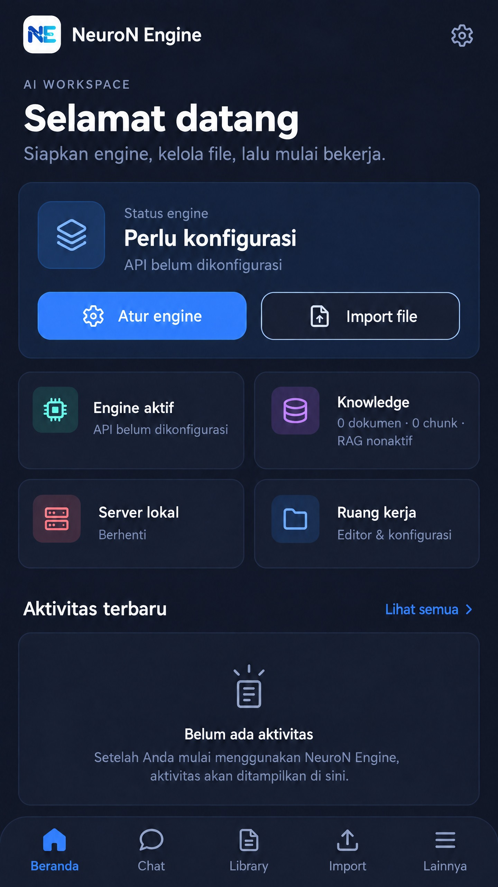

# UI terbaru NeuroN Engine — v0.2.4 alpha

## Arah desain

UI Android kini memakai shell mobile-first dengan **Beranda, Chat, Library, Import, dan Lainnya** sebagai navigasi utama. Tampilan editor-first bergaya IDE dengan rail permanen di kiri sudah dipensiunkan dari alur utama. Editor konfigurasi tetap tersedia di **Lainnya → Editor project / Workspace**, tanpa rail lama; pemilihan file dilakukan melalui tombol pada header Workspace. Fitur server, model lokal, Hugging Face, Knowledge/RAG, Copilot, Hardware, dan Training tersedia dari menu Tools sesuai status implementasinya.

Gambar ini adalah mockup visual untuk mendokumentasikan arah UI, bukan screenshot hasil render Flutter atau bukti bahwa semua kontrol telah diuji di perangkat.

## Navigasi dan layar

- **Beranda:** status engine, ringkasan server dan knowledge/RAG, shortcut Chat/Import, serta aktivitas terbaru.
- **Chat:** percakapan berdiri sendiri; pengaturan engine dapat dibuka dari header.
- **Library:** model lokal dan dokumen knowledge yang terdaftar; Dataset dan Adapter diberi status belum tersedia.
- **Import:** memisahkan pemilihan dari perangkat, Hugging Face, dan folder aplikasi. Import perangkat meminta tujuan Model GGUF atau Knowledge/RAG.
- **Lainnya:** pintu masuk Workspace, Activity, tools, guardrails, dan pengaturan.
- **Workspace:** editor project, pemilih file dalam bottom sheet, toolbar kode/inspektur, serta status validasi JSON.
- **Activity:** log lokal aplikasi yang tersedia saat ini; progress unduhan HF tetap pada layar Hugging Face.

Biru menjadi aksen aksi utama; ungu dipertahankan untuk fitur AI. Implementasi memakai `flutter_app/lib/app_pages.dart`, `main.dart`, `feature_workspace.dart`, dan bridge Kotlin yang sudah ada; perubahan ini tidak menambah layanan backend atau permission baru.

## Batas fitur

UI hanya mengaktifkan alur yang benar-benar terhubung. Import multi-select dan review, Activity manager persisten, impor dataset/wizard training Flutter, unduh lewat URL, cloud storage, transfer LAN, operasi Library seperti rename/export/delete, dan review diff Copilot belum tersedia. Inferensi model lokal tetap memerlukan library native llama.cpp yang cocok dengan ABI perangkat.

## APK dan verifikasi

Versi aplikasi untuk rilis ini `0.2.4+6` (tag `v0.2.4`). Workflow `.github/workflows/release-apk.yml` menjalankan `flutter analyze`, `flutter test`, tes/kompilasi Kotlin, lalu `flutter build apk --release` tanpa split ABI dan melampirkan APK serta checksum ke GitHub Release. R8 dan resource shrinking dimatikan pada build alpha karena dependency opsional membawa referensi kelas yang tidak tersedia di Android; APK lebih besar dan belum dioptimalkan.

Keystore rilis belum disetel untuk build ini. Jika GitHub Actions Secrets signing kosong, Gradle memakai debug signing bawaan dan APK hanya untuk **uji instalasi**, bukan distribusi produksi atau Play Store. Workflow mendukung keystore privat melalui GitHub Actions Secrets; rilis produksi juga memerlukan uji perangkat nyata. APK tidak menyediakan inferensi lokal jika library llama.cpp native tidak disertakan.

## Saran tahap lanjut

1. Siapkan keystore rilis privat dan GitHub Actions Secrets sebelum distribusi di luar pengujian.
2. Jalankan APK pada perangkat kecil dan tablet untuk memeriksa navigasi, keyboard, pemilih file, serta alur chat/import.
3. Bangun Library/Activity persisten serta alur import bertahap: pilih → review → validasi → progress/cancel/retry → simpan.
4. Lanjutkan fitur Dataset/Training dan review diff Copilot sebelum mengaktifkan shortcut yang belum tersedia.
